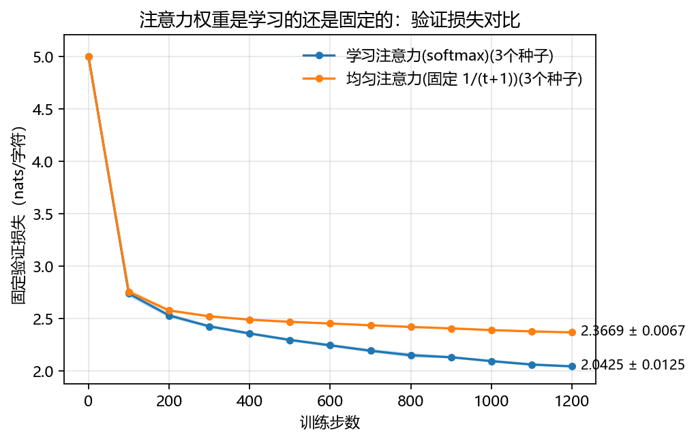

# 消融实验一：均匀注意力 vs 学习注意力

## 1. 现象
本文的两种注意力变体(均匀注意力与可学习权重)均分别使用了3个随机种子(42,43,44)训练了1200步。每100步在固定的10个验证批次上评估损失，取平均值为验证损失。
两组注意力变体最终平均验证损失分别为：2.0425 ± 0.0125(learned)，2.3669 ± 0.0067(uniform)。相差0.3244。
第0步两组的平均验证损失分别为4.9979和4.9972，几乎相同。
第300步和600步时均匀注意力与可学习权重的验证损失差分别为0.0958和0.2082，自第100步起，两种模型的差距单调扩大。
均匀注意力模型最后200步每100步损失下降分别为：第1000步到第1100步下降了0.0126，最后100步下降了0.0092。而可学习权重注意力模型最后200步每100步损失下降分别为：0.0328和0.0174。均匀模型损失已经趋平而可学习模型损失还在下降。
3个随机种子损失的标准差最大值分别为：0.0586(可学习)和0.0576(均匀)。

## 2. 解释
两个变体的网络结构、参数量、数据与训练步数相同，差别只在注意力权重的来源：均匀模式固定为 $\frac{1}{t+1}$，学习模式由 $QK^\top$ 经 softmax 得到（均匀模式下 $W_Q$、$W_K$ 不参与训练，其副作用见第 4 节第 1 条）。一种可能的解释是：字符级预测所需的信息在位置上分布不均——决定下一个字符的证据往往集中在前一两个位置（词尾、标点、空格）。这一猜测之下，等权平均把所有可见位置按 $\frac{1}{t+1}$ 摊平，随 $t$ 增大单个位置的贡献持续下降，模型无法把权重集中到有用处；学习模式由 $QK^\top$ 计算位置相关的权重，因而具备把权重集中到有用位置的能力。这一能力看起来不是结构自带的：第 0 步两组验证损失分别为 4.9979 与 4.9972，几乎相同；差距自第 100 步起单调扩大，到第 1200 步达到 0.3244。形态上，均匀变体在第 1000 步之后每 100 步仅下降约 0.01，而学习变体仍保持约 0.017–0.033 的降幅，提示前者的上限可能由"前缀平均能承载的信息量"决定，后者在 1200 步时尚未到达其上限。

## 3. 文献对照(FNet)
FNet（Lee-Thorp 等，2022）把 Transformer encoder 的 self-attention 子层替换为无参数的傅里叶变换，在 GLUE 上达到对应 BERT 模型 92–97% 的精度，同时 GPU 训练快 80%。

该工作的核心问题是"位置混合是否需要学习"，与本文的消融属于同一族：两者都把注意力权重从可学习改为固定，观察性能损失多大。

两者的可比性有限。FNet 面向 encoder 与分类任务，本文是 decoder 与字符级自回归；FNet 的固定变换是傅里叶变换，其权重虽不学习，但随位置变化（不同频率分量），而本文的均匀注意力在同一行内对所有可见位置给出完全相同的权重，且是因果的；参数量也相差三个数量级（FNet 基于 BERT-base 规模，本文为 118,272）。

结论方向也不同：FNet 显示固定混合可保留大部分精度，本文显示固定混合明显更差（0.3244 nats/字符，约 26 倍种子间标准差）。这一差异可能源于两处：其一，均匀注意力是比傅里叶变换更弱的固定混合，连位置相关的权重都不具备；其二，字符级预测对局部精确匹配的要求更高，等权平均的损失更明显。

## 4. 局限

1. 两组变体并非严格等容量\
均匀模式下 $W_Q$、$W_K$ 不参与计算，收不到梯度，共 16,384 个参数（占总数 13.9%）未被训练。因此本文比较的是"学习权重 + 全部参数"与"固定权重 + 少 13.9% 可训练参数"，二者差异中混有容量因素。

2. 多头在均匀模式下退化\
均匀模式下各头的注意力权重完全相同，多头的"多种关注模式"能力不存在，其多头结构仅通过不同的 $W_V$ 提供多样性。

3. 只有 3 个种子\
标准差由 3 个种子估计，估计误差较大，"26 倍标准差"这一比值不宜过度解读。但即便 $\sigma$ 估偏一倍，0.32 的差距仍远超噪声，结论方向不受影响。

4. 1200 步未收敛\
学习变体在第 1200 步仍在下降，尚未收敛，因此本文的结论限于 1200 步的训练预算；更长训练下差距可能扩大，也可能收敛。

5. 单一语料与单一规模\
1.1 MB 语料、118,272 参数、32 字符窗口。无法推断模型放大后固定混合是否仍然吃亏——这直接限制了本文结论与 FNet 结果的可比范围。

## 参考文献

Lee-Thorp, J., Ainslie, J., Eckstein, I., & Ontañón, S. (2022). FNet: Mixing Tokens with Fourier
Transforms. *NAACL 2022*. arXiv:2105.03824. https://arxiv.org/abs/2105.03824

